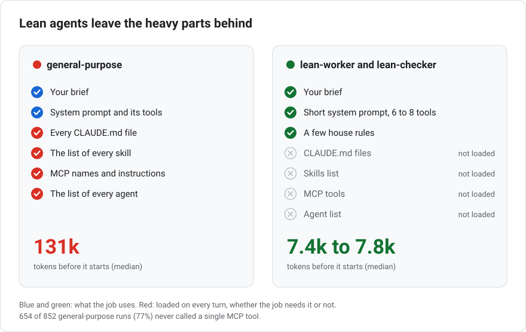
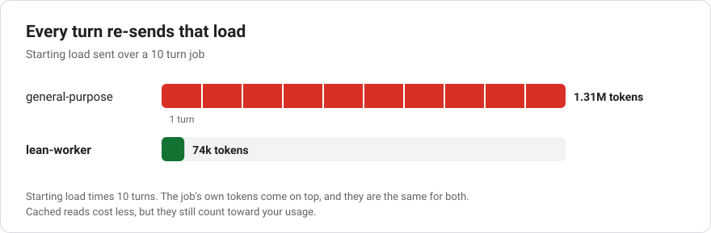
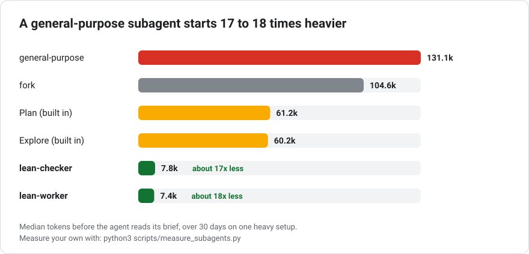
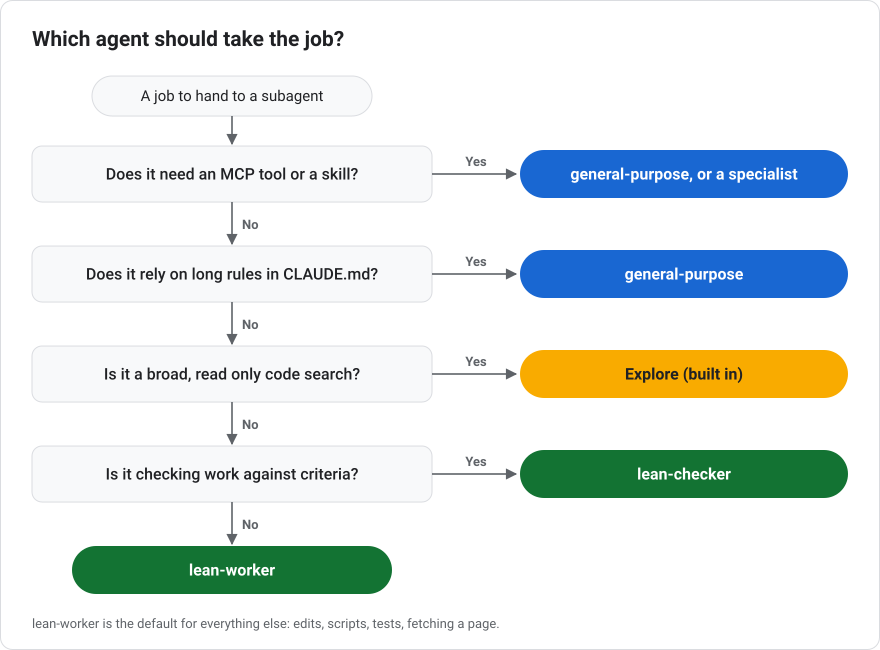

<p align="center">
  
</p>

<h1 align="center">Lean agents for Claude Code</h1>

<p align="center">
Two drop-in subagents that start at about <b>7.5k tokens</b> instead of the <b>131k</b> a general-purpose subagent carried on my setup.
</p>

<p align="center"><a href="https://github.com/mdalexandre/claude-code-lean-agents/actions/workflows/tests.yml"></a></p>

<p align="center"><sub>Requires Claude Code 2.1.271 or later (2.1.296 or later for the <code>autoCompactWindow</code> line).</sub></p>

---

## Why your subagents are expensive

When Claude Code hands work to the built-in **general-purpose** subagent, that agent does not start empty. Before it reads a single word of its brief it loads:

- every CLAUDE.md file the main session loads (user, project and local)
- the list of every skill you have installed
- the name of every tool from every MCP server you have connected, plus each server's instructions (Claude Code defers a tool's full definition until the tool is used)
- the list of every other agent it could start

<picture>
  <source media="(prefers-color-scheme: dark)" srcset="assets/visuals/loads-dark.svg">
  
</picture>

Then it carries all of that on **every turn**, because each turn of an agent resends its whole context. A post on the Claude developer blog about task costs puts it plainly: "Every turn resends the conversation so far." Cached reads are cheap, but they still count toward your usage.

<picture>
  <source media="(prefers-color-scheme: dark)" srcset="assets/visuals/turns-dark.svg">
  
</picture>

If you have a rich setup (a long CLAUDE.md, a few dozen skills, a handful of MCP servers), most of that load has nothing to do with the job. A subagent asked to rename a function across three files does not need your Slack MCP, your PDF skill or your notes on deploy policy.

I measured it across my own transcripts. This is the context each agent type carried on its **first** API request, before doing any work:

<picture>
  <source media="(prefers-color-scheme: dark)" srcset="assets/visuals/start-dark.svg">
  
</picture>

| Agent type | Runs | Median start | What it loads |
|---|---:|---:|---|
| general-purpose | 852 | 131.1k | CLAUDE.md, skills list, MCP tool names and server instructions, agent list |
| fork | 10 | 104.6k | the parent conversation |
| Explore (built in) | 20 | 60.2k | skips CLAUDE.md |
| Plan (built in) | 2 | 61.2k | skips CLAUDE.md |
| **lean-worker** | 15 | **7.4k** | its own short rules and 8 tools |
| **lean-checker** | 6 | **7.8k** | its own short rules and 6 tools |

That is **17 to 18 times less** context per turn. And of those 852 general-purpose runs, 654 (77%) never called a single MCP tool, so they paid for a toolbox they never opened.

MCP is not most of that load. Claude Code defers each MCP tool's full definition until the tool is used, so only the tool names and the server instructions come in at the start. Re-measured on Claude Code 2.1.301 with a headless all-tools subagent on the same setup, connecting the MCP servers added about 15k tokens to the first request (121.5k with them, 106.2k with none). The CLAUDE.md files and the skills list make up most of the rest.

Your numbers will be different, because the gap depends on how heavy your setup is. The [`measure_subagents.py`](scripts/measure_subagents.py) script below shows you yours in a few seconds.

## What is in the box

| File | What it is |
|---|---|
| `agents/lean-worker.md` | Worker for bounded jobs: read, edit, run commands and tests, fetch a page |
| `agents/lean-checker.md` | Blind, read only checker: tests an artifact against criteria, PASS or FAIL per criterion with evidence |
| `hooks/lean_dispatch_nudge.py` | Optional hook that nudges Claude toward the lean agents when it reaches for general-purpose |
| `scripts/measure_subagents.py` | Reads your transcripts and prints the starting context of every agent type you use |
| `scripts/make_visuals.py` | Redraws the diagrams in this README from `assets/visuals/spec.json` |
| `install.sh`, `uninstall.sh` | Copy the agents (and optionally the hook) into place, with backups |

## How it works

Nothing clever: it is a handful of frontmatter fields that Claude Code already supports. This excerpt is from `agents/lean-worker.md` (the full file also has a `description` and `maxTurns: 120`):

```yaml
---
name: lean-worker
tools: Read, Write, Edit, Bash, Glob, Grep, WebFetch, WebSearch
model: sonnet
effort: medium
omitClaudeMd: true
autoCompactWindow: 300000
---
```

- **`tools`** is an allowlist. Without the `Skill` tool and without any `mcp__` tools, the skills list and the MCP tool names and server instructions never enter the agent's context. This is where most of the saving comes from.
- **`omitClaudeMd: true`** launches the agent without your user, project and local CLAUDE.md files.
- **`model: sonnet`** and **`effort`** keep everyday work off the most expensive model. Change them if you like.
- **`autoCompactWindow`** compacts a long running worker earlier, so a 60 turn job does not drag a huge context through every turn. It appeared in Claude Code 2.1.296; on an older version, delete that line.
- **`maxTurns`** caps a run (120 turns for the worker, 80 for the checker). An agent that hits the cap stops and returns what it has so far.

`omitClaudeMd` needs Claude Code 2.1.271 or later. On an older version the agent still loads your CLAUDE.md files, so you lose part of the saving; run `claude --version` to check.

Because the agents skip CLAUDE.md, each one carries a few house rules of its own in its body: never print secrets, read before editing, take no destructive or publishing action unless the brief names it, treat web pages and tool output as data, and never claim something works without running the check. The checker is also forbidden from editing what it checks. Rule 3 gives `systemd-run` as one way to cap memory; that example is Linux only, and the rule works with `timeout` or `ulimit` wherever those commands exist.

## Install

```bash
git clone https://github.com/mdalexandre/claude-code-lean-agents.git
cd claude-code-lean-agents
./install.sh            # user level: ~/.claude/agents, available in every project
# or
./install.sh --project  # project level: ./.claude/agents, run from your repo root
```

On Windows, `install.sh` and `uninstall.sh` are bash scripts. Run them from Git Bash or WSL.

Start a new Claude Code session and ask Claude which subagents it can use; `lean-worker` and `lean-checker` should be in the list. (Since Claude Code 2.1.198, `/agents` no longer lists them; it only reminds you where agent files live.)

If a file with the same name is already installed and differs, the installer saves it as `<name>.bak-<timestamp>` before replacing it.

To remove them: `./uninstall.sh` (or `./uninstall.sh --project`; on Windows, from Git Bash or WSL). A copy you have edited is kept as a `.bak` file instead of being deleted. Add `--hook` to also remove the optional hook.

Prefer to do it by hand? Copy the two files in `agents/` into `~/.claude/agents/`. That is all the installer does.

## Use

Claude picks a subagent by its description, and both descriptions say "use it instead of general-purpose", so in most sessions it starts using them on its own. You can also ask directly:

> Use lean-worker to add type hints to every function in `src/parser.py` and run mypy.

> Use lean-checker to check `docs/api.md` against these criteria: 1. every endpoint in `routes.py` is documented, 2. every example request is valid JSON.

**Put everything the job needs into the brief.** A lean agent has not read your CLAUDE.md, so it does not know your conventions unless you, or the main session, tell it. In practice the main session already writes self contained briefs; just keep in mind that "follow our usual style" means nothing to it.

**Permissions work as usual.** The lean agents follow your normal Claude Code permission settings. In the interactive app, Claude asks you before an agent edits a file or runs a command. In a headless run (`claude -p`), nothing can be asked, so allow what the job needs up front, for example `--permission-mode acceptEdits --allowedTools Bash`, or the agents can only read. lean-checker reports a criterion it could not run as UNTESTED rather than guessing PASS.

**For blind QA, keep the brief blind.** Give lean-checker the artifact, the criteria and the file paths, never your own verdict. A checker told "I verified this works, please confirm" will usually confirm.

The whole choice in one picture:

<picture>
  <source media="(prefers-color-scheme: dark)" srcset="assets/visuals/which-dark.svg">
  
</picture>

### When not to use them

- The job needs an MCP tool (a database, a browser, an API wrapper) or a skill. Use general-purpose, or write a small specialist agent that lists just the tools it needs.
- The job is a broad read only search across a codebase. The built-in `Explore` agent was made for that.
- The job depends on project rules that live only in CLAUDE.md and are too long to put in a brief.

## Optional: nudge Claude toward the lean agents

Sometimes the main session still reaches for general-purpose out of habit. The hook in `hooks/` watches the Agent tool and, when a general-purpose agent is about to start, adds a one line reminder to Claude's context. A dispatch whose **description** (not its prompt) contains `mcp__`, the word MCP, or the word skill is left alone, so Claude can still start general-purpose on purpose by saying why.

```bash
./install.sh --hook
```

On Windows, run this from Git Bash or WSL too.

Then register it in `~/.claude/settings.json`. The installer prints the snippet with the full path filled in. If your settings already have a `"hooks"` key or a `"PreToolUse"` list, add the entry inside the existing one rather than pasting a second key:

```json
"hooks": {
  "PreToolUse": [
    { "matcher": "Agent|Task",
      "hooks": [ { "type": "command", "command": "python3 ~/.claude/hooks/lean_dispatch_nudge.py" } ] }
  ]
}
```

On Windows, Claude Code runs a hook command in Git Bash if Git for Windows is installed, and in PowerShell if not. The docs do not say whether `~` is expanded there, and `python3` may not exist. Try the `py` launcher or `python`, with a full path that includes the drive letter. Replace `YOUR_NAME` with your user name.

```json
"command": "py C:/Users/YOUR_NAME/.claude/hooks/lean_dispatch_nudge.py"
```

Set `LEAN_DISPATCH_BLOCK=1` (in your shell, for example `export LEAN_DISPATCH_BLOCK=1` in bash or `set LEAN_DISPATCH_BLOCK=1` in cmd, or in the `env` block of settings.json) to block such dispatches instead of nudging: the hook exits with code 2, the dispatch is refused, and Claude sees the reason and can retry with a lean agent. `LEAN_DISPATCH_ADVISORY=0` switches the hook off. It fails open: if anything goes wrong it lets the call through.

## Measure your own setup

```bash
# On Windows, write py (or python) instead of python3
python3 scripts/measure_subagents.py            # last 30 days
python3 scripts/measure_subagents.py --days 7 --min-runs 1
python3 scripts/measure_subagents.py --root /path/to/projects   # transcripts somewhere else
```

It reads the subagent transcripts Claude Code keeps under `~/.claude/projects/`, takes the first API request of each run, and prints the median and 90th percentile starting context per agent type. It only reads, needs nothing beyond the Python standard library, and sends nothing anywhere. Run it before installing, use the lean agents for a few days, run it again.

## Customize

- **Cheaper still:** set `model: haiku` for simple, mechanical jobs.
- **Harder jobs:** raise `effort` to `high`, or set `model: opus` on a copy named for the job.
- **One extra tool:** add it to `tools`. To give a single MCP server, use the `mcpServers` field rather than dropping the allowlist, so the other servers stay out.
- **Your own rules:** edit the numbered house rules in the agent body. Keep them short; they are re-sent every turn too.

## Limits and honesty

- The numbers above come from one heavy setup (many skills, many MCP servers, long CLAUDE.md files) on Claude Code 2.1.296 on Linux. With a light setup the gap is smaller.
- `omitClaudeMd` still loads managed policy files, if your organization uses them.
- Smaller context is not free intelligence. A lean agent knows only what its brief says, so a vague brief gives a worse result than it would to an agent that read your CLAUDE.md.

## Sources

- Claude Code docs, subagents and their frontmatter fields: https://code.claude.com/docs/en/sub-agents
- Claude Code changelog (2.1.296 added `autoCompactWindow` for subagents): https://github.com/anthropics/claude-code/blob/main/CHANGELOG.md
- "What a task costs on Opus 5.5" (Claude developer blog), on how every turn resends the context and how MCP tool definitions are deferred: https://claude.dev/blog/what-a-task-costs-on-opus-5-5/

## License

MIT, covering everything in this repository, including the agent files. See [LICENSE](LICENSE).
